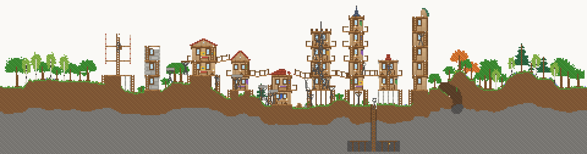
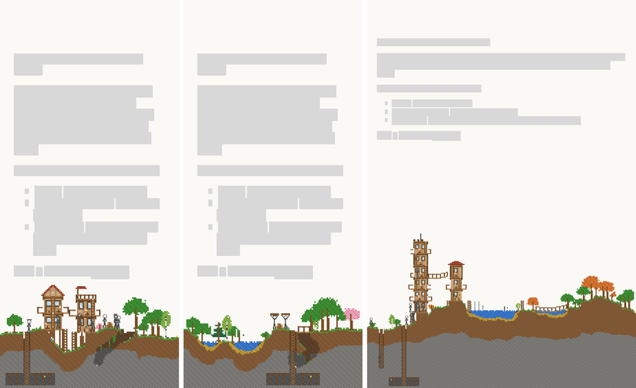
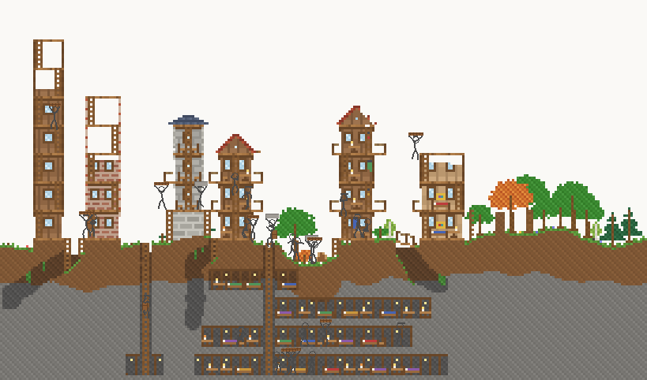
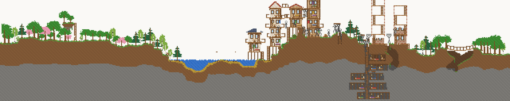

# Colony benchmark: generations

The goal: leave a randomly generated guy society alone and have it fill the screen
with business, like an ant colony.

## The benchmark

`npx tsx scripts/particles-bench/bench.mts --label genN --shots` leaves 16 worlds alone
for 100,000 ticks each (about 40 minutes of the landing page at its normal speed): 4
fixed random seeds on each of the landing page's real text layouts at 4 screen sizes
(laptop 1440×900, HD 1920×1080, tablet 820×1180, phone 390×844, captured with
`capture-layouts.mjs`).

**Score** is measured every 5,000 ticks, in per mille of the screen:

- cells the colony has changed: anything built (in front or behind) plus natural
  ground dug out (loose sand doesn't count)
- minus a stuck-guy penalty, converted to cells: 25 per emergency teleport home,
  0.02 per tick spent stranded, 0.02 per tick walking without getting anywhere
  (or hopping between the same few cells), 0.02 per tick hanging about in one small
  spot for 3,000+ ticks while neither working nor relaxing

The headline **score** is the average over the whole run (so getting going early
counts as well as where it ends up); **final** is the score at 100k ticks and
**worst** is the weakest of the 16 worlds at 100k, which is the "reliably" part.

Rules: no changes to world generation and no new materials. New structures and
behaviours are fine.

## Generations

Only generations that pushed the frontier are listed.

| gen | score | final | worst | penalty | guys | ms/tick | what changed |
|----:|------:|------:|------:|--------:|-----:|--------:|--------------|
| 0 | 14.85 | 9.47 | -135.6 | 26.5 | 26.9 | 0.80 | baseline |
| 1 | 25.02 | 41.12 | -20.3 | 5.7 | 29.3 | 0.90 | ant-nest tunnels and gallery rooms; stuck-step and doomed-site fixes |

### Gen 0: baseline

Score 14.85, final 9.47, worst -135.6 (by screen: laptop 41, HD 25, tablet 17,
phone -44).

The curve climbs to about 20 by 60k ticks and then *falls*: building stalls at
about 6,000 changed cells on the big screens while the stuck penalty keeps
mounting.

What was holding it back:

- **Nothing left to do.** Once the towers reach their tier's height and the
  planner runs out of sites, crowds of guys stand about at home. The stuck
  penalty counts them, which is the point: an ant colony doesn't stand still.
- **Phones are cramped.** The text leaves a thin strip of sky over the ground,
  so towers barely fit. One phone world built nothing at all in 100k ticks.
- **The ground is unused.** Apart from a single mine, the whole ground band
  (a sixth of the screen) is untouched.
- **A loop at the stockpile.** Guys try to start a build, fail, walk to the
  stockpile, wait and try again, for thousands of ticks.

### Gen 1: the nest

- **Ant-nest tunnels.** A finished mine becomes a nest: the planner keeps
  carrying its galleries further and opening new levels off the shaft (every 12
  rows), always through solid natural ground with solid ground over and under,
  with a timber post every 4 cells under a beam along the roof and a lantern now
  and then. There's always digging to do, and it needs no materials.
- **Gallery rooms.** Finished stretches of gallery become rooms, furnished like
  tower rooms (floor furniture only: there's no wall to hang things on). More
  furniture brings more guys, so phones can grow even with no room for towers.
- **A nest counts toward the tech tier**, and a colony with no tower can still
  plan mines, tunnels and bridges (before, it only ever tried towers).

Fixes found along the way:

- **Unreachable steps stalled projects forever.** A failed attempt only counted
  if the safe map had been redrawn in the last 5 ticks, which after a 40-tick wait
  almost never happens, so a step nobody could reach was never skipped. Failures
  now always count (a quarter as much when the map is stale), and after a run
  of failures guys go back to the first unbuilt step, which is usually the stuck one.
- **Doomed towers were planned again and again.** One phone world planned the
  same unreachable tower 13 times, each abandoned after 2,000 ticks. Abandoned
  sites are now remembered for 30,000 ticks.

Score 25.02, final 41.12 (4.3x), worst -20.3. The curve now climbs all the way.

Still limited:

- **Everything happens near home.** On wide screens, half the world is never
  touched: mines are only sited near the stockpile, towers go next to towers.
- **Building is mostly walking.** Late in a run guys spend 55% of their time
  walking to build sites and 24% to and from the stockpile, and 1.3% building,
  because a guy carries at most 400 wood (half a storey).
- **Stone piles up** (20,000 in one world) while wood runs short and towers wait
  as bare frames.

